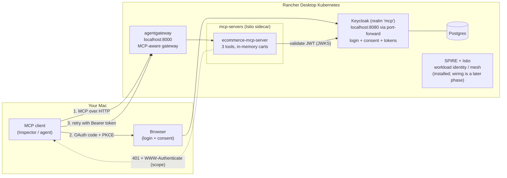

# Guide: infra, architecture, and testing with MCP Inspector

Reference for the demo e-commerce MCP server and the local platform it runs on.
Two repos: **`mcp-ecosystem-infra`** (reusable platform, Terraform) and **`ecommerce-mcp-server`** (this app).

## 1. What this demonstrates

An AI agent (MCP client) can **browse and add to cart anonymously**, exactly like a website visitor.
To **check out**, the customer must sign in (Keycloak) and **consent** to the agent buying on their
behalf. Consent is asked once; later logins skip it. Payment/shipping come from the customer's saved
profile, never through the agent.

## 2. Architecture



```
Client ──MCP──▶ agentgateway :8000 ──▶ ecommerce-mcp-server (Service :80 → pod :3000)
   │                                            │ verifies JWT signature/iss/aud/scope
   └──OAuth (browser)──▶ Keycloak :8080 ◀── JWKS ┘
```

### Request flow for checkout (step-up auth, per MCP spec)

1. `initialize` → server issues `Mcp-Session-Id`; gateway pairs it with the client's session.
2. `product_search`, `add_to_cart` → no token; cart is keyed by the session.
3. `one_step_checkout` with no token → **401** + `WWW-Authenticate: Bearer resource_metadata=…, scope="ecommerce:checkout"`.
4. Client reads `/.well-known/oauth-protected-resource/mcp` → finds Keycloak → Authorization Code + **PKCE** with that scope.
5. Customer logs in; Keycloak shows **consent** the first time (stored per user + client).
6. Client retries with the token → server validates it, **claims the session cart into the customer's cart**, orders using the saved profile, returns an order id.

### The tools

| Tool | Auth | Notes |
|---|---|---|
| `product_search(query?, category?, maxPrice?, limit?)` | none | 10 seed products |
| `add_to_cart(productId, quantity)` | none | session cart; customer cart once signed in |
| `one_step_checkout()` | token with scope `ecommerce:checkout` | 401 without token, 403 `insufficient_scope` without scope |

Seed data: `src/seed.ts` (products; customer `testuser` with a Visa ending 4242 and a Springfield address).

### Components and versions (all official/upstream)

| Component | Version | Source |
|---|---|---|
| Istio (base, istiod) | 1.30.5 | `istio-release.storage.googleapis.com/charts` |
| SPIRE (+ CRDs chart 0.6.1) | chart 0.30.3 | `spiffe.github.io/helm-charts-hardened` |
| agentgateway (OSS) | 1.6.0 | `oci://cr.agentgateway.dev/charts` |
| Keycloak Operator | 26.8.0 | `keycloak/keycloak-k8s-resources` |
| Gateway API CRDs | v1.5.1 | shipped by k3s/Traefik in Rancher Desktop |
| MCP SDK | `@modelcontextprotocol/sdk` 1.32.x | npm |

## 3. Infra setup (one time)

Prerequisites: Rancher Desktop (Kubernetes ≥ 1.30, Docker/moby engine), `kubectl`, `terraform`, `helm`.

```bash
cd mcp-ecosystem-infra/terraform
terraform init
terraform apply          # ~5 min: namespaces, SPIRE, Istio, Keycloak (+realm `mcp`), agentgateway + Gateway
```

What Terraform creates: namespaces (`spire-system`, `istio-system`, `agentgateway-system`, `keycloak`,
`mcp-servers`), the Keycloak operator + Postgres + Keycloak CR + realm `mcp` (client `mcp-test-client`,
user `testuser`), and a Gateway `agentgateway-proxy` listening on **8000**. Rancher Desktop publishes
that LoadBalancer on `localhost:8000` automatically.

Secrets (never committed):

```bash
terraform output -raw keycloak_admin_password
terraform output -raw test_user_password      # password for `testuser`
```

Then deploy the app (from this repo):

```bash
docker build -t ecommerce-mcp-server:dev .                 # Rancher's Docker is shared with k8s: no registry
KC_ADMIN_PASSWORD=$(terraform -chdir=../mcp-ecosystem-infra/terraform output -raw keycloak_admin_password) \
  scripts/keycloak-setup.sh                                # audience / groups / ecommerce:checkout scopes; idempotent
kubectl apply -k deploy/k8s                                # Deployment, Service, AgentgatewayBackend, HTTPRoute
kubectl port-forward -n keycloak svc/keycloak-service 8080:8080   # keep running; issuer is http://localhost:8080
```

Why Keycloak needs the port-forward: tokens carry `iss=http://localhost:8080/realms/mcp`, so clients
must reach Keycloak at that address. The gateway needs no port-forward.

Health check:

```bash
kubectl get pods -A | grep -v kube-system                  # everything Running
curl localhost:8000/.well-known/oauth-protected-resource/mcp   # JSON with authorization_servers
curl -s -o /dev/null -w '%{http_code}\n' localhost:8080/realms/mcp   # 200
```

After a Rancher Desktop restart, pods come back by themselves; only re-start the Keycloak port-forward.

## 4. Testing with MCP Inspector

Server entry (already in the repo): [`inspector/mcp.config.json`](../inspector/mcp.config.json)
→ `ecommerce` = streamable HTTP at `http://localhost:8000/mcp`.

### 4a. Automated smoke test (CLI)

```bash
TEST_USER_PASSWORD=$(terraform -chdir=../mcp-ecosystem-infra/terraform output -raw test_user_password) \
  scripts/inspector-smoke.sh
```

Expected: 7 PASS — tool list; anonymous search; anonymous add_to_cart; checkout without login
triggers the OAuth challenge (`auth_required`); then with a real customer token: add_to_cart, checkout
returns `ord_…`, card ending 4242. Without `TEST_USER_PASSWORD` the authenticated checks are skipped.

Single calls by hand:

```bash
I="npx -y @modelcontextprotocol/inspector@latest --cli --config inspector/mcp.config.json --server ecommerce"
$I --method tools/list
$I --method tools/call --tool-name product_search --tool-arg query="running shoes"
$I --method tools/call --tool-name add_to_cart --tool-arg productId=bottle-001 --tool-arg quantity=2
```

Each CLI call is its own MCP session, so anonymous carts do not carry across calls (by design).
A signed-in customer's cart does.

Get a token for header-based tests: `TEST_USER_PASSWORD=… npx tsx scripts/get-token.ts`
→ pass as `--header "Authorization: Bearer <token>"`.

### 4b. Web UI walkthrough

```bash
npx -y @modelcontextprotocol/inspector@latest --web --config inspector/mcp.config.json
```

Open the URL it prints (it contains a one-time API token). Then:

1. **Connect** to the `ecommerce` server. *Expect:* connected, 3 tools listed.
2. **product_search** with `query = running shoes`. *Expect:* two shoe products.
3. **add_to_cart** `productId = shoe-trail-001`, `quantity = 1`. *Expect:* cart total 89.99.
4. **one_step_checkout** (no arguments). *Expect:* a 401 and Inspector offering/starting **OAuth**.
5. Complete OAuth (see "Client registration for Inspector" below for the two ways to get a client id).
   Log in as `testuser` / the `test_user_password`. *Expect:* **consent screen on the first login only.**
6. Run **one_step_checkout** again. *Expect:* `ord_…`, total 89.99, card `visa •••• 4242`,
   Springfield address. The anonymous cart from step 3 was claimed into the order.
7. To see consent again: Keycloak admin console → realm `mcp` → Users → `testuser` → Consents → revoke.

Note: steps 4–5 follow the standard MCP OAuth flow and were verified headlessly (same requests via
`test/e2e`), but I could not drive the Inspector's browser UI in the build session — treat the exact
button labels as approximate.

### Client registration for Inspector

An OAuth client needs a `client_id` before it can log anyone in. Inspector's redirect URI is
`http://localhost:6274/oauth/callback`. Two ways:

**A. Dynamic registration (RFC 7591) — Inspector does it automatically.** Inspector reads Keycloak's
`registration_endpoint` from the discovery metadata and registers itself as a public PKCE client.
`scripts/keycloak-setup.sh` makes this work for localhost only: it adds `localhost`/`127.0.0.1` to the realm's
*Trusted Hosts* policy, allows the `ecommerce:checkout` scope for anonymous registrations, and offers that
scope to new clients. Keycloak's *Consent Required* policy forces every dynamically registered client through
the consent screen. Leave the client-ID field empty in Inspector's auth settings. Each Inspector session may
register a new client (up to the realm's *Max Clients* limit of 200); consent is per client, so a newly
registered client sees the consent screen again.

**B. Pre-registered client.** Enter client ID `mcp-test-client` (public, PKCE, redirect URIs
`http://localhost:*`) in Inspector's OAuth settings. Consent is remembered across sessions because the id is stable.

Manual check of A:

```bash
curl -s -X POST localhost:8080/realms/mcp/clients-registrations/openid-connect \
  -H 'content-type: application/json' \
  -d '{"client_name":"MCP Inspector","redirect_uris":["http://localhost:6274/oauth/callback"],"grant_types":["authorization_code","refresh_token"],"response_types":["code"],"token_endpoint_auth_method":"none","scope":"ecommerce:checkout"}'
```

Expect JSON with a `client_id`. `Host not trusted` means `scripts/keycloak-setup.sh` has not been run.

Inspector is a browser app, so its discovery, registration and token calls are cross-origin. Keycloak allows
that for the Inspector origin; the server serves its discovery document with `Access-Control-Allow-Origin: *`,
and the gateway route has a CORS filter for `localhost:6274/6277` (`deploy/k8s/gateway-route.yaml`).

### 4c. Full automated journey (no Inspector)

```bash
MCP_URL=http://localhost:8000/mcp \
TEST_USER_PASSWORD=… KC_ADMIN_PASSWORD=… npm run test:e2e
```

## 5. Development loop

```bash
npm ci && npm test            # 54 unit/in-process tests, no network
npm run typecheck
docker build -t ecommerce-mcp-server:dev . && kubectl apply -k deploy/k8s
kubectl -n mcp-servers rollout restart deploy/ecommerce-mcp-server   # picks up the rebuilt image
```

Wait ~15 s after a rollout before testing (first request through a fresh pod can time out).
Set `DEBUG_REQUESTS=true` in `deploy/k8s/shop-mcp.yaml` to log request shapes (header names, never values).

## 6. Troubleshooting

| Symptom | Cause / fix |
|---|---|
| `localhost:8080` returns 404 | Something else holds 8080 (Rancher forwards LoadBalancer ports). The gateway must listen on 8000, not 8080; restart the Keycloak port-forward. |
| `invalid_token: token has no subject` | Realm lacks Keycloak's built-in scopes; infra realm must not declare its own `clientScopes`. |
| First call after rollout: `upstream call timeout` | Pod warming up; retry after ~15 s. |
| Inspector OAuth: "Failed to fetch" / registration error | Re-run `scripts/keycloak-setup.sh` (trusted hosts + scope policy) and redeploy so the CORS filter and discovery CORS headers are live. Check the browser dev-tools Network tab for the failing URL. |
| Consent screen never appears | Consent already stored; revoke it (4b step 7) or re-run the e2e (it resets consent). |
| Token rejected: audience | `scripts/keycloak-setup.sh` must run with `RESOURCE_URL` equal to the deployment's `RESOURCE_URL` (`http://localhost:8000/mcp`). |

## 7. Known limits and next steps

- Carts/orders are in memory; single replica.
- Only the gateway should reach the server; an Istio `AuthorizationPolicy` for that is not yet applied.
- Planned next: a **session-manager** at the gateway (link agent ↔ customer on consent, merge carts across
  sessions, invalidate older sessions, detect changed CIMD documents), Dynamic Client Registration / CIMD for agents,
  SPIRE-issued mesh identities, TLS everywhere.
- agentgateway keeps the client's session itself; the server's own `Mcp-Session-Id` is what the
  upstream sees, so a session-manager must map the two.
