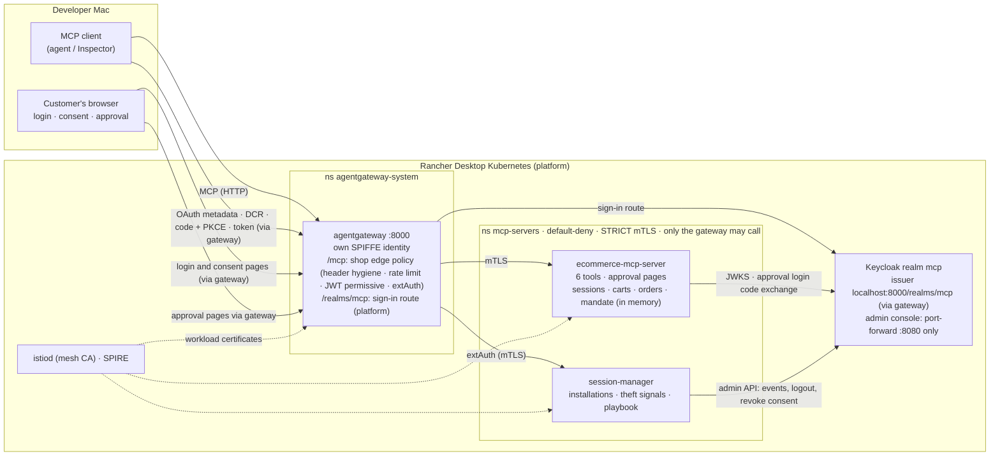

# Guide: architecture, design decisions, and how to run it

Reference for the demo e-commerce MCP server and the local platform it runs on. Both are a **proof of concept**:
the shop is a demo (not a real store) and the platform is a laptop lab on Rancher Desktop (not production). The
goal is to learn how MCP clients we do not control can misuse a shop that lets AI agents buy for customers, and
which design keeps it safe while staying easy for legitimate shoppers.

Companion documents:
- [SECURITY-POSTURE.md](SECURITY-POSTURE.md): trust boundaries, security decisions, every attack vector and what
  stops it, security processes (verification, incident runbooks).
- [MCP-COMPLIANCE.md](MCP-COMPLIANCE.md): compliance report against the MCP specification (2025-11-25, readiness for 2026-07-28).
- [ATTACK-RESULTS.md](ATTACK-RESULTS.md): latest run of the attack lab against the live stack.
- [CLIENT-COMPATIBILITY-REPORT.md](CLIENT-COMPATIBILITY-REPORT.md): shareable summary of client test results and recommended design changes.
- [HARNESSES.md](HARNESSES.md): real MCP clients (Inspector, Claude Code, Codex, OpenClaw, Hermes) against the shop, and the client compatibility catalogue that feeds the design.
- [plans/SIGN-IN-ON-CONNECT.md](plans/SIGN-IN-ON-CONNECT.md): the implemented plan (stories S0–S12) for sign-in on first connect.
- `mcp-ecosystem-infra/docs/onboarding.md`: the platform's contract for MCP server teams.

Contents: [1 What it does](#1-what-it-does) · [2 Architecture](#2-architecture) ·
[3 Design decisions](#3-design-decisions-and-why) · [4 Processes](#4-processes-step-by-step) ·
[5 Testing](#5-testing) · [6 Troubleshooting](#6-troubleshooting) · [7 Known limits](#7-known-limits)

---

## 1. What it does

An AI agent (MCP client) **signs the customer in when it first connects** (OAuth, both scopes, one consent per app);
from then on it can browse, fill the customer's cart and check out without another sign-in. All of the customer's
agents share one cart; each line names the app that added it. (`REQUIRE_SIGN_IN=false` restores the earlier design:
anonymous browsing, sign-in and step-up only at checkout.) To **buy**:

1. the agent is already signed in with the purchase scope (consented to at the first sign-in);
2. for each purchase, unless it fits the customer's **spending mandate** (0 today), the agent hands the customer a
   link; the customer **signs in again on the shop's own page**, sees items, total, card and address, and clicks
   **Approve and pay**, which places the order and shows its id;
3. the agent confirms with `list_orders` (or `one_step_checkout` again, which returns the same order).

A stolen token, a misbehaving agent or an injected prompt can fill a cart but cannot spend money beyond the
mandate. Payment and shipping come from the customer's saved profile, never through the agent.

### Tools

| Tool | Who may call | Behaviour |
|---|---|---|
| `product_search(query?, category?, maxPrice?, limit?)` | signed-in customer (anyone if `REQUIRE_SIGN_IN=false`) | 10 seed products; text is sanitised and marked third-party |
| `add_to_cart(productId, quantity)` | signed-in customer (anyone: session cart) | the customer's shared cart; the line records the app that added it |
| `view_cart()` | signed-in customer (anyone) | exactly what checkout would buy, who added each line, whether approval will be needed and the mandate left |
| `remove_from_cart(productId, quantity?)` | signed-in customer (anyone) | removes a line or reduces it (e.g. an item the customer did not ask for) |
| `one_step_checkout()` | customer token with `shop:api` + `ecommerce:checkout` | `401` without a token, `403 insufficient_scope` without the scope; then `placed` (within the mandate) or `approval_required` with a link; after approval `placed` with the order |
| `list_orders(orderId?, limit?)` | customer token with `ecommerce:checkout` | the customer's own orders, newest first: id, status, how authorised, time, total, items, card, address |

Limits: $500 per order, $1,000 per customer per 24 h (agent purchases), 10 per line, 25 lines per cart.

---

## 2. Architecture

### 2.1 Two repos: a platform and an MCP server on it

| Repo | Owner | Contains |
|---|---|---|
| **`mcp-ecosystem-infra`** (Terraform) | platform team | Everything shared and its security baseline: Kubernetes namespaces, Istio (trust domain `cluster.local`), SPIRE, Keycloak (realm `mcp`, test client, test user), agentgateway with the shared Gateway on `localhost:8000`, the gateway's mesh identity, per-namespace baseline (default-deny, STRICT mTLS, only the gateway may call), realm hardening, and **tenant onboarding**. |
| **`ecommerce-mcp-server`** (this repo) | application team | The shop and its session-manager, their Kubernetes and gateway manifests (`deploy/k8s`), [`platform/tenant.yaml`](../platform/tenant.yaml) (what the shop needs from the platform), tests and the attack lab. Holds no platform credentials. |

### 2.2 Components



| Component | Role | Code / config |
|---|---|---|
| agentgateway | MCP-aware gateway: terminates and pairs MCP sessions, routes `/mcp`, `/approve`, discovery; applies the shop's edge policy | platform; route + policy in `deploy/k8s/gateway-route.yaml`, `gateway-policy.yaml` |
| Shop MCP server | Tools, OAuth resource-server checks (JWT, scopes, DPoP), server-issued sessions, carts, approvals, orders, mandate, audit log, approval web pages | `src/` (entry `src/bin/shop.ts`) |
| Session-manager | Gateway extAuth: tracks each *installation* `(sub, client, Keycloak session)`, detects token theft, ends sessions | `src/session-manager/` (entry `src/bin/session-manager.ts`), same image |
| Keycloak | Identity provider: login, consent, tokens, dynamic client registration, events | platform realm `mcp`; shop's scopes and clients from `platform/tenant.yaml` |
| Istio + NetworkPolicy | Only the gateway's identity can reach the shop; mTLS on that hop | platform (`modules/mcp-servers-baseline`) |

### 2.3 Request flow and trust

1. Every request enters through the gateway on `localhost:8000`. The gateway **removes** client-supplied trust headers
   (`x-trust-tier`, `x-installation-id`, `x-mcp-session-id`) and **sets** `x-forwarded-for` to the address it saw.
2. Rate limit per client address; JWT validated if present (permissive: an invalid or expired token is passed on so
   the shop can answer with the OAuth challenge clients need).
3. extAuth asks the session-manager: is this token family ended? which trust tier? It answers allow + `x-trust-tier`,
   or `401`.
4. The request reaches the shop over mTLS; nothing else can (NetworkPolicy + STRICT mTLS + AuthorizationPolicy on the
   gateway's SPIFFE id). That is why the shop may believe the gateway's headers (`TRUST_GATEWAY_HEADERS=true`).
5. The shop re-validates the token itself (issuer, audience = `http://localhost:8000/mcp`, expiry, scopes, DPoP when
   bound) and checks its own session registry.

### 2.4 Checkout sequence

```mermaid
sequenceDiagram
  autonumber
  participant A as Agent (MCP client)
  participant G as Gateway
  participant S as Shop
  participant K as Keycloak
  participant H as Customer (browser)
  A->>G: initialize, product_search, add_to_cart (no token)
  G->>S: (session issued by the shop; cart keyed by it)
  A->>S: one_step_checkout (no token)
  S-->>A: 401 WWW-Authenticate: resource_metadata, scope="shop:api ecommerce:checkout"
  A->>K: discovery + authorization code + PKCE (customer logs in, consents once)
  A->>S: one_step_checkout (Bearer token)
  S->>S: claim session cart → customer cart; check caps
  alt cart fits the spending mandate
    S-->>A: placed (authorizedBy: spending_mandate)
  else needs approval
    S-->>A: approval_required + approvalUrl (nothing charged)
    A->>H: "please approve: <link>"
    H->>S: open link → redirected to Keycloak, prompt=login (fresh sign-in)
    S->>K: code exchange (shop-approval client); check same customer, fresh auth_time
    S-->>H: review page: items, total, card, address
    H->>S: Approve and pay (CSRF token, same-origin)
    S->>S: place the exact approved cart (hash, idempotency key)
    S-->>H: "Order ord_… for $… is placed"
    A->>S: one_step_checkout or list_orders
    S-->>A: placed: same order (no double charge)
  end
```

### 2.5 State and data model

| Thing | Keyed by | Lifetime | Notes |
|---|---|---|---|
| MCP session | server-issued UUID | 30 min idle, 24 h max | capped in total and per source; unknown ids → `404` |
| Anonymous cart | `session:<id>` | 2 h idle | merged into the customer cart on checkout or `view_cart` |
| Customer cart | `customer:<sub>` | 24 h idle | **one per customer**, shared by all their clients and devices |
| Approval request | random 256-bit id | 5 min | bound to customer + exact cart hash; ≤ 5 open per customer (oldest dropped) |
| Order | `customer:<sub>` | process lifetime | `authorizedBy`: `customer_approval`, `spending_mandate`, `direct` (dev) |
| Spending mandate | `sub` (profile) | config | amount per rolling window; usage computed from `spending_mandate` orders |
| Installation (session-manager) | `(sub, azp, sid)` | process lifetime | networks seen, first/last seen, terminated flag |

All of it is **in memory** (POC): a restart empties carts, orders, approvals, mandate usage and the installation
registry. Profiles are seed data keyed by `sub` (`DEMO_PROFILE_SUBJECTS`).

### 2.6 Versions

| Component | Version | Source |
|---|---|---|
| Istio (base, istiod) | 1.30.5 | `istio-release.storage.googleapis.com/charts` |
| SPIRE (+ CRDs chart 0.6.1) | chart 0.30.3 | `spiffe.github.io/helm-charts-hardened` |
| agentgateway (OSS) | 1.6.0 | `oci://cr.agentgateway.dev/charts` |
| Keycloak Operator / server | 26.8.0 | `keycloak/keycloak-k8s-resources` |
| Gateway API CRDs | v1.5.1 | shipped by k3s/Traefik in Rancher Desktop |
| MCP SDK | `@modelcontextprotocol/sdk` 1.32.x | npm |

---

## 3. Design decisions and why

Product and platform decisions. Security decisions (approval as the control, edge JWT mode, header trust,
registration stance, theft signals, …) are in [SECURITY-POSTURE.md §3](SECURITY-POSTURE.md#3-security-design-decisions).

| # | Decision | Alternatives considered | Why |
|---|---|---|---|
| D1 | **Platform repo builds everything shared; app repos only declare needs** in `tenant.yaml` | Each app installs/configures its own gateway/IdP pieces; app scripts with the Keycloak admin password | App teams should build MCP servers, not operate identity and networking. Holding platform admin credentials in app repos would let any team reconfigure the realm. One onboarding path also lets the platform enforce guard-rails (no path/name collisions, no privilege escalation). |
| D2 | **Tenant file in the app repo, registered by the platform team** (`tenants = {…}` in tfvars), applied by `terraform apply` | Self-service API/operator; tickets | Keeps the app's needs versioned with the app, keeps the decision to admit a tenant with the platform, and needs no extra controller for a POC. A Kubernetes operator/CRD is the natural production evolution. |
| D3 | **Shared `mcp-servers` namespace or a dedicated one, tenant's choice** | Dedicated always; shared always | Shared is zero-effort for small servers; dedicated gives RBAC isolation of Secrets. Both get the same network/mesh baseline. Teams in the shared namespace share trust. |
| D4 | **One trust domain (`cluster.local`) for all MCP servers** | Per-team trust domains; SPIRE trust domain `mcp.lab.internal` | Single local cluster; Istio's default; identities are already distinct per namespace/service account. SPIRE as CA is a later phase. |
| D5 | **agentgateway** as the gateway | kgateway (earlier plan), Envoy + custom filters, Apigee | Open source, Gateway API native, understands MCP (sessions, JSON-RPC methods, tool names), and joins the Istio mesh natively with its own SPIFFE identity (no sidecar). |
| D6 | **Gateway reaches the shop through a label-selected backend** (`selector`), not a `static` host | `static` host + TLS policy | Only selector/Service backends use the mesh identity; a static host is plaintext, which STRICT mTLS rejects. The label value is the server's own name so another tenant's Service is never picked up. |
| D7 | **The shop issues MCP session ids and validates them** | Trust the gateway's session; client-chosen ids | Per MCP spec; makes guessed/forged ids useless even if the gateway were bypassed. (The gateway pairs its client-facing session with the shop's.) |
| D8 | **Stateless MCP transport per request**, state in shop services | SDK's stateful sessions | Works behind a gateway that multiplexes sessions; keeps state in one place that can later move to a database. |
| D9 | **One cart per signed-in customer, shared by all their clients**; anonymous carts merge into it | One cart per installation | Matches how shop accounts work across devices; lets the customer see and fix everything from any client. Consequence: two clients checking out at once buy the cart once. |
| D10 | **Every purchase needs the customer's approval on a shop-rendered page, unless within the mandate** | Token scope alone; token age (`max_age`) check; CIBA/push | The only control that holds against stolen tokens, rogue agents and prompt injection without depending on client behaviour. A same-device link is the POC delivery; production would move it out of band (push, CIBA, passkey) without changing the server design. |
| D11 | **Clicking "Approve and pay" places the order**; the agent then confirms | Approval only marks; agent's next call buys | The button must do what it says; otherwise an approved purchase silently never happens if the agent does not call again. The order is exactly the approved cart (hash) and idempotent (approval id). |
| D12 | **Spending mandate = budget per window on the customer's account**, default 0 | Per-order threshold; per-installation budget; no mandate | A per-order threshold is defeated by splitting a purchase across clients; a per-installation budget multiplies with every device. One shared budget, checked and recorded in one step, holds under concurrent checkouts from many devices. 0 keeps "approve everything" until the customer opts in. |
| D13 | **No MCP tool can change the mandate or limits** | `set_mandate` tool | An agent must not be able to raise its own allowance. In production the customer sets it on the website after signing in. |
| D14 | **Limits checked before asking for approval**, and again when placing | Only when placing | Never send a customer through a sign-in for an order that cannot be placed; re-checking at placement covers budget used in between. |
| D15 | **A decline is reported to the agent once; a deliberate retry gets a fresh link** | Remember the decline for the approval lifetime | A remembered decline blocked a customer who changed their mind for 5 minutes. Telling the agent once prevents silent loops; every new link still needs the customer. |
| D16 | **Session-manager as a separate service behind extAuth** | Inside the shop; inside the gateway | Theft detection is cross-cutting (could serve every MCP server later); keeping it out of the shop keeps the shop simple and lets the gateway refuse ended token families before they reach any server. |
| D17 | **In-memory state, one replica** | Postgres now | POC speed. Every place that must become transactional with a database is called out (mandate check, idempotency, approvals). |
| D18 | **Secure defaults in config** (approval required, gateway headers untrusted, DPoP optional) | Permissive defaults | A misconfigured deployment fails closed. `REQUIRE_APPROVAL=false` refuses to start without being explicit. |
| D20 | **Follow the MCP spec's server-side security rules even where impact is low**: Origin allow-list + route hostnames, sessions bound to their customer, only `shop:api` advertised | Accept low-impact deviations | Spec conformance is what lets clients we do not control behave predictably; each fix was small. Evaluation: [SECURITY-POSTURE.md 4.11](SECURITY-POSTURE.md#411-mcp-specification-conformance). |
| D21 | **Sign-in on the shared gateway, same origin as the MCP endpoint** (issuer `http://localhost:8000/realms/mcp`; platform module `auth-route`). Only realm `mcp` is routed; master realm, admin console and admin API are not | Keycloak on its own origin (`:8080` port-forward) | Some clients refuse OAuth fetches to a private-network origin other than the MCP server's ([HARNESSES CC-4](HARNESSES.md#cc-4-openclaw-only-reaches-a-private-network-authorization-server-at-the-mcp-servers-origin): OpenClaw). One front door is also the production shape: one TLS endpoint, one place for rate limits and client-address handling. Consequence: DCR's sender-address check is off (behind a load balancer it sees the balancer); redirect URIs must still be loopback. |
| D22 | **Sign in on first connect with both scopes** (`REQUIRE_SIGN_IN`, default true; supersedes "only `shop:api` advertised" in D20) | Anonymous browsing + step-up at checkout (the earlier design, still available with `false`) | Of the agent clients tested, none starts a sign-in mid-session; all can sign in before use, and one sign-in with both scopes avoids step-up, which Keycloak refuses for scopes a client did not register. Carts, mandates and browsing then follow the customer from the first call. Evidence: [CLIENT-COMPATIBILITY-REPORT.md](CLIENT-COMPATIBILITY-REPORT.md), [HARNESSES.md](HARNESSES.md) |
| D23 | **One cart per customer, shared by all their agents; each line names the app that added it** | Per-agent carts merged at checkout | Checkout and the mandate judge the whole customer cart anyway; attribution (self-declared app name + client id) lets the customer remove what an agent added unasked, on `view_cart` and the approval page |
| D24 | **Linked apps expire after 30 days** (platform job deletes self-registered clients and revokes consents; offline sessions end at 30 days) | Keycloak defaults | A periodic fresh start for every agent; platform-owned because clients and consents are realm-wide (`mcp-ecosystem-infra` `modules/client-expiry`) |
| D19 | **Approval page uses `Referrer-Policy: same-origin`** | `no-referrer` | Under `no-referrer` browsers send `Origin: null` on form posts, which the anti-CSRF origin check correctly refuses: the customer's own click was blocked. `same-origin` sends the real origin and still nothing to other sites. |

---

## 4. Processes, step by step

Prerequisites: Rancher Desktop (Kubernetes ≥ 1.30, dockerd engine, Traefik on for the Gateway API CRDs), `kubectl`,
`terraform`, `helm`, Node ≥ 24, Python 3. Both repos side by side (`~/mygithub/…`).
Note: `terraform -chdir=` does not expand `~`; use `INFRA=$(cd ../mcp-ecosystem-infra/terraform && pwd)`.

### 4.1 Build the platform (platform team, once)

```bash
cd ../mcp-ecosystem-infra/terraform
terraform init
terraform plan  -var-file=environments/local/terraform.tfvars    # review: replacements of null_resources run kubectl delete
terraform apply -var-file=environments/local/terraform.tfvars
```

Creates namespaces, SPIRE, Istio, Keycloak + realm `mcp` + realm baseline, agentgateway + Gateway on `:8000` with
its mesh identity, the `mcp-servers` baseline, and onboards every registered tenant. Verify:
`kubectl get pods -A`, `terraform output tenants`.

### 4.2 Onboard an MCP server (once per server, repeat after changing `tenant.yaml`)

1. **App team:** write `platform/tenant.yaml` (template: `mcp-ecosystem-infra/examples/sample-tenant.yaml`): namespace,
   gateway paths, scopes, clients, service-account roles, Secret name.
2. **Platform team:** add it to `tenants` in `terraform/environments/local/terraform.tfvars`, then
   `terraform plan` (collision checks run here) and `terraform apply` (namespace if dedicated, Keycloak objects,
   Secret).
3. **App team:** deploy (4.3). For the shop this is already done: `tenants = { ecommerce = "../../ecommerce-mcp-server/platform/tenant.yaml" }`.

### 4.3 Deploy the shop (app team)

```bash
kubectl port-forward -n keycloak svc/keycloak-service 8080:8080   # admin console and admin API only; sign-in is on :8000
docker build -t ecommerce-mcp-server:dev .                        # Rancher's Docker is shared with k8s: no registry
kubectl apply -k deploy/k8s                                       # shop, session-manager, backend + route, edge policy
kubectl -n mcp-servers rollout restart deploy/ecommerce-mcp-server deploy/session-manager   # after rebuilding the image
```

Sign-in mode: `REQUIRE_SIGN_IN` in `deploy/k8s/shop-mcp.yaml` (`"true"`: sign in on first connect; `"false"`: the
earlier anonymous-first design). Switch a running shop for a comparison with
`kubectl -n mcp-servers set env deploy/ecommerce-mcp-server REQUIRE_SIGN_IN=false`; `kubectl apply -k deploy/k8s`
puts the manifest's value back. The tests, probe and attack lab detect the mode from the advertised scopes.

If the realm was recreated, `testuser` has a new id: put it in `DEMO_PROFILE_SUBJECTS` (`deploy/k8s/shop-mcp.yaml`):

```bash
INFRA=$(cd ../mcp-ecosystem-infra/terraform && pwd)
TEST_USER_PASSWORD=$(terraform -chdir=$INFRA output -raw test_user_password) npx tsx scripts/get-token.ts --sub
```

### 4.4 Verify a deployment

```bash
kubectl get pods -A | grep -v kube-system                         # all Running; shop and session-manager 2/2
curl localhost:8000/.well-known/oauth-protected-resource/mcp      # resource, authorization_servers, scopes_supported
curl -s -o /dev/null -w '%{http_code}\n' localhost:8000/realms/mcp   # 200: sign-in endpoints on the gateway
TEST_USER_PASSWORD=… scripts/inspector-smoke.sh                   # 14 PASS
```

### 4.5 Buy something (as a customer, with MCP Inspector)

See [5.2](#52-mcp-inspector-web-ui-walkthrough). Username `testuser`; password:
`terraform -chdir=$INFRA output -raw test_user_password`.

### 4.6 Change the spending mandate

```bash
kubectl -n mcp-servers set env deploy/ecommerce-mcp-server DEMO_MANDATE_CENTS=5000 MANDATE_WINDOW_HOURS=24  # $50 / 24 h
kubectl -n mcp-servers set env deploy/ecommerce-mcp-server DEMO_MANDATE_CENTS=0                            # back to approve-everything
```

Persist it in `deploy/k8s/shop-mcp.yaml`. (A restart resets mandate usage, as all state is in memory.)

### 4.7 After the laptop slept (expired mesh certificates)

While the laptop sleeps, the Rancher Desktop VM is frozen: its internal clocks stop, its wall clock is corrected on
wake. Istio renews workload certificates on the internal clock, so after a long sleep they can be expired by the wall
clock (gateway error `invalid peer certificate: certificate expired`). Recover:

```bash
kubectl -n mcp-servers rollout restart deploy/ecommerce-mcp-server deploy/session-manager
kubectl -n agentgateway-system rollout restart deploy/agentgateway      # controller xDS certificate, same cause
kubectl port-forward -n keycloak svc/keycloak-service 8080:8080          # admin console, if the port-forward died
```

Check a certificate: `kubectl -n mcp-servers exec deploy/ecommerce-mcp-server -c istio-proxy -- pilot-agent request GET certs`.
(Proposed platform fix: a CronJob that detects a VM freeze and restarts meshed workloads automatically.)

### 4.8 Develop

```bash
npm ci && npm run check   # typecheck + lint + 182 unit/in-process tests, no network
```

Configuration is env vars, validated at start-up (`src/config/shop.ts`, `src/config/session-manager.ts`); defaults are the secure ones. Browser clients must be
listed in `ALLOWED_ORIGINS` (`deploy/k8s/shop-mcp.yaml`; Inspector's origins today); the shop's route accepts only
`Host: localhost` and `127.0.0.1`. `DEBUG_REQUESTS=true`
logs request shapes (header names only). Audit events are JSON lines with `"audit":true` on stdout of both pods.

### 4.9 Security checks before calling a change done

1. `npm test` (unit, including attack cases).
2. `scripts/inspector-smoke.sh` (real client path through the gateway).
3. `npm run test:e2e` (full journey including approval in a headless browser).
4. `npx tsx test/attack/lab.ts --report=docs/ATTACK-RESULTS.md` (all personas, live). Expected today: everything
   held except D4 (look-alike client registration, known open item).

Details and incident runbooks: [SECURITY-POSTURE.md §6](SECURITY-POSTURE.md#6-security-processes).

---

## 5. Testing

### 5.1 MCP Inspector CLI smoke test

```bash
TEST_USER_PASSWORD=$(terraform -chdir=$INFRA output -raw test_user_password) scripts/inspector-smoke.sh
```

14 checks: the six tools; anonymous search, add, `view_cart` (empty in a fresh session), `remove_from_cart` of an
absent item (clear error); checkout without login triggers the OAuth challenge; with a customer token, add and
checkout answers `approval_required` with a link to `localhost:8000/approve/…`. Anonymous checks run with an empty
`HOME`, because Inspector reuses tokens stored from web-UI sign-ins.

Single calls: `npx -y @modelcontextprotocol/inspector@latest --cli --config inspector/mcp.config.json --server ecommerce --method tools/list`.
Each CLI call is its own MCP session (anonymous carts do not carry over; a customer's cart does).
Token for header tests: `TEST_USER_PASSWORD=… npx tsx scripts/get-token.ts` → `--header "Authorization: Bearer <token>"`.

### 5.2 MCP Inspector web UI walkthrough

```bash
npx -y @modelcontextprotocol/inspector@latest --web --config inspector/mcp.config.json
```

1. **Connect** to `ecommerce`. *Expect:* 6 tools.
2. **product_search** `query = running shoes`. *Expect:* two shoes.
3. **add_to_cart** `shoe-trail-001` ×1, then `bottle-001`; **view_cart** shows both; **remove_from_cart** `bottle-001`.
   *Expect:* total 89.99.
4. **one_step_checkout**. *Expect:* 401 and Inspector starting OAuth (it registers itself).
5. Log in as `testuser`. *Expect:* the consent screen (first time for this registration).
6. **one_step_checkout** again. *Expect:* `approval_required` and an `approvalUrl`; nothing charged.
7. Open the `approvalUrl` in your browser. *Expect:* Keycloak asks you to sign in **again** (by design), then the
   review page: item, $89.99, Visa ending 4242, Springfield address. Click **Approve and pay**.
   *Expect:* "Order placed: `ord_…` for $89.99".
8. **list_orders**. *Expect:* that order first, `status: placed`, `authorizedBy: customer_approval`.
   **one_step_checkout** again returns the same order ("not charged again").
9. To see consent again: Keycloak admin console → realm `mcp` → Users → `testuser` → Consents → revoke.

How Inspector gets a client id: **dynamic registration** (leave the client-ID field empty; allowed for local clients
by the realm baseline, with the shop's scopes added at onboarding) or the pre-registered **`mcp-test-client`**
(public, PKCE, redirect `http://localhost:*`; consent remembered). Discovery, registration and token calls are
cross-origin: Keycloak allows Inspector's origins, the shop's discovery document allows any origin without
credentials, and the MCP route's CORS allows only `localhost:6274/6277`.

### 5.3 End-to-end journey (no Inspector)

```bash
MCP_URL=http://localhost:8000/mcp TEST_USER_PASSWORD=… npm run test:e2e
```

Anonymous browse/cart → 401 → discovery → PKCE login + consent → `approval_required` → approval in a headless browser
→ order → later login without consent. Restarts the shop first for clean state (`RESET_SHOP=0` to skip). With the
platform's `KC_ADMIN_PASSWORD` it also resets and asserts the first-time consent screen.

### 5.4 Attack lab

```bash
TEST_USER_PASSWORD=… [KC_ADMIN_PASSWORD=…] npx tsx test/attack/lab.ts [--only=A,C] [--report=docs/ATTACK-RESULTS.md] [--no-reset]
```

`KC_ADMIN_PASSWORD` (platform credential) enables I1, which retires a client the way the expiry job does.

Plays each kind of client live: legitimate shopper (must stay easy), anonymous bot, token thief, rogue client
registration, malicious website, in-cluster attacker, floods, refresh-token theft with the live session-manager
response. Prints HELD / GOT THRU. Restarts the shop first; signed-in scenarios start from an empty customer cart;
floods and theft run last (they rate-limit and reset the lab user for a few minutes).

### 5.5 Real agent harnesses, headless

The harness CLIs can be driven from a script; two helpers stand in for the customer's browser:

```bash
TEST_USER_PASSWORD=… npx tsx scripts/sign-in-for-harness.ts '<authorization URL the harness printed>' [--print-callback]
TEST_USER_PASSWORD=… npx tsx scripts/approve-as-customer.ts '<approval link the agent showed>'
```

Examples: `codex mcp login shop` prints the URL; `claude mcp login --no-browser shop` asks for the callback URL to be
pasted (`--print-callback`); `openclaw mcp login shop` prints the URL. Then `codex exec`, `claude -p` or
`openclaw agent -m` run the shopping prompts. Results and the per-client notes: [HARNESSES.md](HARNESSES.md).

### 5.6 Planned: many clients on many devices

Covered by unit tests today (`test/unit/mcp/server.test.ts`, "spending mandate"): one shared budget across devices;
two carts that each fit but not together (one bought, one sent to approval); two devices checking out the same
shared cart (one order). The live test should add N separate installations (different `sid`) checking out
concurrently through the gateway; mandate exhaustion mid-burst; window roll-over; a `cooling_off` installation;
and, before scaling past one replica, the same burst against a shared database.

---

## 6. Troubleshooting

| Symptom | Cause / fix |
|---|---|
| Gateway `500 … invalid peer certificate: certificate expired` | Mesh certificates expired while the laptop slept. [4.7](#47-after-the-laptop-slept-expired-mesh-certificates). |
| New gateway pod not Ready: `invalid peer certificate: certificate expired` (xDS) | agentgateway controller certificate, same cause. Restart `deploy/agentgateway`. |
| `403 Origin not allowed` on `/mcp` | A browser client whose origin is not in `ALLOWED_ORIGINS`. Add it (and to the route's CORS list) if legitimate. |
| `404` from the gateway for a new hostname | The shop's route accepts only `localhost` / `127.0.0.1`; add hostnames in `gateway-route.yaml`. |
| `404 Session not found` after switching accounts | Sessions are bound to their first customer; reconnect (new session) when signing in as someone else. |
| Approval page says **Blocked** | Cross-site or `Origin: null` POST refused. Fixed by `Referrer-Policy: same-origin` (D19); reload the link. |
| Approval page says **Not placed** | Limits or the cart changed between request and click. Nothing charged; check out again. |
| Checkout `approval_required` forever | Open the `approvalUrl`, sign in, click Approve and pay; `list_orders` shows the order. Links expire after 5 min. |
| Checkout: "Orders over $500…" / "Daily spending limit…" | Caps, checked before any approval. Trim with `view_cart` / `remove_from_cart` (customer carts persist 24 h). |
| Checkout: "The customer declined…" | Told once after a decline; calling again asks for a new approval. |
| Checkout: "This sign-in is new…" | Cooling-off after a theft reset (15 min) or the optional new-installation cooling-off. |
| `401 … this sign-in was ended for your protection` | The session-manager ran the theft playbook. Sign in again. |
| DCR `403 … Allowed Client Scopes` | A scope not on the registration allow-list (`openid`, `offline_access` + tenants' scopes). Re-run `terraform apply` in the platform. |
| DCR `403 … Trusted Hosts` / `Invalid origin` | Registration from a non-local host or an origin not in the realm baseline. |
| DCR or login `500` | Keycloak client-policy executor misconfigured (check Keycloak logs). |
| `invalid_token` / audience | Token lacks `shop:api`; the shop's challenge asks for it. |
| Gateway `500 … backend TLS … SPIFFE is not enabled` / `Connection reset by peer` to the shop | Backend is a `static` host. Use the label `selector` target (D6); re-apply `deploy/k8s`. |
| Inspector CLI `invalid_grant … Offline user session not found` | Stored tokens were revoked (theft playbook, offline limits); Inspector discards them; rerun. |
| Smoke test "anonymous" checks see a signed-in cart | Stored Inspector tokens; the script uses an empty `HOME` for those checks. |
| `429` everywhere in the lab | Rate limits (all lab clients share one address). Wait a minute. |
| `localhost:8000/realms/mcp` returns 404 | Sign-in route missing: re-apply the platform (`module.auth_route`). |
| `localhost:8080` returns 404 / connection refused | Admin port-forward not running (needed for the admin console, e2e consent reset and admin scripts only). |
| First call after rollout times out | Pod warming up; retry after ~15 s. |

## 7. Known limits

- State is in memory, one replica; mandate checks and idempotency must become database transactions to scale.
- Approval is a same-device link (production: push/CIBA/passkey on another device); no MFA on the approval login yet.
- Anonymous dynamic registration accepts look-alike clients (lab only).
- HTTP everywhere except gateway↔workload (mTLS); mesh CA is istiod, not SPIRE; namespaces need PSA `privileged`.
- Teams could route another team's paths by applying an HTTPRoute directly (admission policy not built); no tenant
  offboarding; mandate set by config, not by the customer.
- Mesh certificates and the gateway controller's certificate can expire after the laptop sleeps (4.7).

Full list with priorities: [SECURITY-POSTURE.md §5](SECURITY-POSTURE.md#5-what-is-still-open-in-priority-order).
