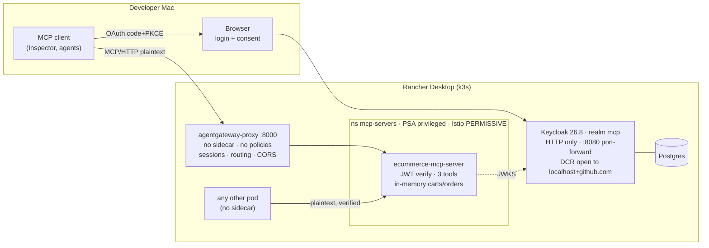
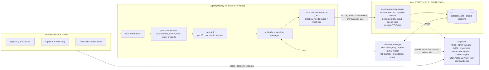
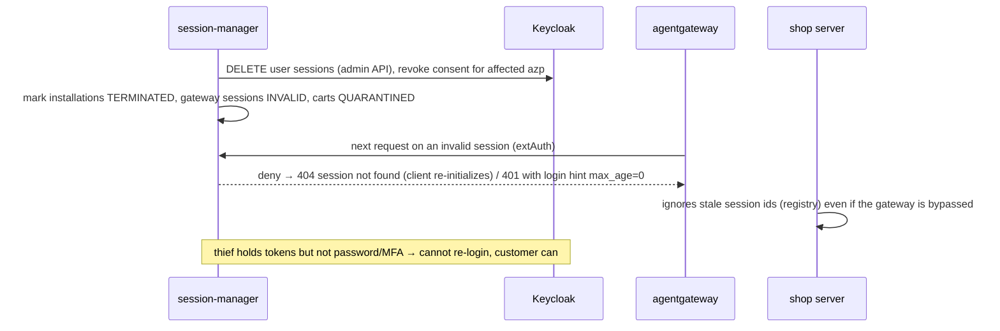

> **Archived 2026-10-08.** This is the original security review of the first version (gaps, target
> architecture, roadmap) plus the implementation-status notes added while building it (section 9).
> Superseded by [../SECURITY-POSTURE.md](../SECURITY-POSTURE.md), which describes the current posture per
> attack vector. Kept unchanged as the historical record; file paths and commands below may be out of date
> (realm-wide Keycloak hardening and the namespace/gateway mesh policies have since moved to `mcp-ecosystem-infra`).

# Security posture, gaps and target architecture

Scope: the e-commerce MCP server as deployed on 2026-10-07 in Rancher Desktop, plus the platform
pieces it depends on (agentgateway, Keycloak realm `mcp`, Istio/SPIRE, Kubernetes namespaces).
Every "verified" statement below was checked against the running system; the commands are in the
appendix. Items marked *unverified* are reasoned from configuration or documentation only.

This is a review document. No code was changed while writing it.

---

## 1. What we are protecting, and from whom

**Assets**
1. The customer's money: `one_step_checkout` charges the saved card and ships to the saved address.
2. The customer's account link: a consent that lets an agent buy on the customer's behalf.
3. Carts and browsing behaviour (low value individually, privacy-relevant in aggregate).
4. Availability of the shop for legitimate agents.

**Actors**
| Actor | Capability assumed |
|---|---|
| Legitimate customer | Runs one or more MCP clients on their own machines; may install new ones any time. |
| Anonymous visitor / bot | Can start any number of MCP sessions; can register OAuth clients dynamically. |
| Token thief | Holds a copied access or refresh token (malware on the customer's machine, leaked logs, a malicious or compromised MCP client). Does **not** hold the customer's password or second factor. |
| Malicious MCP client | A client the customer installed that behaves badly: prompt-injects, hoards tokens, acts outside what the user asked. |
| Content attacker | Controls text the model reads (product descriptions, reviews later) and tries to steer the agent into buying. |
| In-cluster attacker | Code running in another pod/namespace (a compromised neighbour workload). |

**Design constraint that drives everything:** we do not control MCP clients. We cannot push a patch
to them, cannot force them to use a particular library, and cannot distinguish "the customer's
fourth client" from "the thief's first client" by looking at a bearer token.

---

## 2. The system as it runs today



Trust boundaries that exist: host↔cluster (only via the two published ports), gateway↔server (a
Kubernetes Service), customer↔agent (Keycloak consent). Boundary that is **missing**: anything
inside the cluster ↔ the server.

---

## 3. Controls already in place (keep these)

| Control | Where | Note |
|---|---|---|
| JWT signature, `iss`, `aud`, `exp` validated on every authenticated call; `sub` required | server `src/auth/tokens.ts` | Unit-tested against wrong key/issuer/audience/expiry. |
| Step-up via `401`/`403` + `WWW-Authenticate` with scope, per MCP spec; works inside JSON-RPC batches too | server `src/http/app.ts` | Clients cannot reach `one_step_checkout` without the `ecommerce:checkout` scope. |
| Consent required for every client (pre-registered and DCR), stored per user+client | Keycloak policy *Consent Required* | Verified: consent shown first time only. |
| PKCE S256 enforced on `mcp-test-client`; password grant and implicit flow disabled | Keycloak client | |
| Refresh-token rotation with zero reuse; access tokens 5 min | Keycloak realm | Reuse of a rotated refresh token kills the session (Keycloak built-in). |
| Strict `Content-Type: application/json` (415 otherwise) → no CORS "simple request" CSRF | server + gateway | Verified at both hops. |
| Gateway validates its own session ids: bogus/missing `Mcp-Session-Id` → 400; `initialize` required first | agentgateway | Verified. Guessing another client's session **through the gateway** is not practical. |
| 1 MB body limit; tool input validated with zod (quantities 1–10, limit ≤ 50) | server | |
| Container: non-root UID, read-only FS, all caps dropped, CPU/memory limits | `deploy/k8s/shop-mcp.yaml` | |
| Discovery CORS is `*` *without* credentials; MCP route CORS limited to Inspector origins | server / HTTPRoute | Correct split. |
| Keycloak has an operator-managed NetworkPolicy | ns `keycloak` | |
| No secrets in images or repo; passwords live in Terraform state | | State is local and unencrypted (see gap L2). |

---

## 4. Gaps

Severity: **C** critical (exploitable now, direct money/account impact) · **H** high · **M** medium · **L** low.

### 4.1 Verified by test

| # | Sev | Gap | Evidence | What an attacker does |
|---|---|---|---|---|
| C1 | **C** | **Gateway bypass + session forgery.** Any pod can reach the server over plaintext and the server trusts whatever `mcp-session-id` / `x-mcp-session-id` it is sent. | A `curlimages/curl` pod in `default` (no sidecar) called the Service, set `mcp-session-id: victim-session-guess`, and added to that cart: HTTP 200. No `PeerAuthentication` (mTLS PERMISSIVE), no `AuthorizationPolicy`, no `NetworkPolicy` in `mcp-servers`. | A compromised neighbour workload tampers with any anonymous cart whose id it knows, and with a replayed customer token can **check out** on the customer's card. The gateway's own session validation is simply skipped. |
| H1 | **H** | **No rate limiting anywhere.** | 200 unauthenticated requests → 200×HTTP 200 in 0.30 s against the pod; nothing configured at the gateway (`agentgatewaypolicy`: none). | Cart/session flooding exhausts memory (see H2); credential stuffing against Keycloak; DCR flooding up to the 200-client cap. |
| H2 | **H** | **Unbounded in-memory state.** Carts, sessions and orders are `Map`s with no TTL, no cap, no eviction. | `src/domain/cart.ts`, `checkout.ts`. | Combined with H1: one anonymous client creates millions of session carts → OOM → shop down (single replica). |
| H3 | **H** | **PKCE is optional for dynamically registered clients.** Only `mcp-test-client` has the S256 attribute; realm has **no client policies**. | Sample DCR client: `pkce.code.challenge.method` not set. | Authorization-code interception on a public client (malicious app on the customer's machine registering the same loopback redirect) yields a token without the verifier. |
| M1 | **M** | Brute-force protection off, no password policy, no MFA/WebAuthn required. | Realm: `bruteForceProtected: false`, `passwordPolicy: null`. | Password spraying against `testuser`-like accounts, especially with H1. Lab data today, but the consent screen is the gate to spending money. |
| M2 | **M** | Audience is a **realm-wide default scope**: every client, including anything registered via DCR, gets `aud=http://localhost:8000/mcp`. | `scripts/keycloak-setup.sh` adds `mcp-audience` to `default-default-client-scopes`. | A token minted for one client can be presented by another; no per-client audience restriction. Keycloak lacks RFC 8707 resource indicators, so this needs per-client scoping instead. |

### 4.2 Confirmed from configuration / code

| # | Sev | Gap | Where |
|---|---|---|---|
| H4 | **H** | **Customer profile keyed by `preferred_username`**, a mutable claim, not by immutable `sub`. If usernames can ever be changed or reused, order goes to the wrong card/address. | `src/mcp/server.ts` → `placeOrder({ username })`, `src/seed.ts` |
| H5 | **H** | **Offline tokens with no maximum lifespan.** `offline_access` is a realm-default optional scope; `offlineSessionMaxLifespanEnabled: false`, idle 30 days (renews on use). Consent never expires. | Keycloak realm | A stolen refresh token stays valid indefinitely as long as it is used monthly. |
| H6 | **H** | **No proof of recent user presence for checkout.** A token obtained once (possibly long ago) is enough to spend money. No `max_age`/ACR check, no out-of-band approval. | server | This is the gap that makes token theft pay off. |
| H7 | **H** | **Nothing distinguishes a stolen token from a legitimate one** and nothing correlates sessions to a token family. No session registry, no `sid` binding, no device/network signal, no invalidation path. | (absent component) | The scenario in the brainstorm: thief with a copied token looks identical to the customer's third client. |
| M3 | **M** | JWT is validated only at the server; the gateway has **no `jwtAuthentication`, no tool-level `authorization`, no `extAuth`**. Defense in depth and per-tool policy both missing at the edge. | no `AgentgatewayPolicy` |
| M4 | **M** | DCR *Trusted Hosts* includes `github.com`, required because Inspector sends `client_uri=https://github.com/modelcontextprotocol/inspector`. Any URL on github.com now passes the policy. Anonymous registration also permits `openid` + `ecommerce:checkout` scopes for any new client. | `scripts/keycloak-setup.sh` |
| M5 | **M** | **Agent identity is the OAuth `client_id`**, which identifies an *application*, not an *installation*. Under CIMD every install of an app shares one id; under DCR Inspector reuses one id across tabs/sessions. The session-manager plan assumed `client_id` ≈ agent; that assumption is wrong for the stolen-token scenario. | design |
| M6 | **M** | **No idempotency, no spend limit on checkout.** A retried or injected `one_step_checkout` places a second order. | `src/domain/checkout.ts` |
| M7 | **M** | **Prompt-injection surface.** Product text is returned verbatim into the model's context; nothing marks it untrusted; nothing requires the user to confirm the purchase amount. | `src/mcp/server.ts` |
| M8 | **M** | `mcp-servers` namespace is **PSA `privileged`** (needed by `istio-init`). Any pod admitted there can run privileged. | infra namespaces module |
| M9 | **M** | Plain HTTP end-to-end: client→gateway, gateway→server, server→Keycloak JWKS, Keycloak itself (`httpEnabled: true`, no TLS). Acceptable on loopback only. | everywhere |
| M10 | **M** | `x-mcp-session-id` / `mcp-session-id` header fallback accepted from the network (see C1). Intended for gateway-less dev. | `src/http/app.ts` |
| L1 | L | Istio ↔ SPIRE not wired: server has no SPIFFE identity yet; mesh identity is istiod's default CA. | infra |
| L2 | L | Terraform state (admin + test passwords) is a local unencrypted file; passwords were echoed into chat/terminal during setup. | infra |
| L3 | L | Images by mutable tag (`:dev`, `postgres:16-alpine`), not digest-pinned. | manifests |
| L4 | L | 11 throw-away DCR clients left in the realm from debugging. | Keycloak |
| L5 | L | `DEBUG_REQUESTS` logs session ids when on (off by default). Tool error messages are generic. | server |

---

## 5. Attack vectors, mapped

| Vector | Works today? | Closed by |
|---|---|---|
| **Replay a stolen access token** (≤5 min) to check out | Yes, if the victim has a non-empty cart or the thief fills one | H6 (fresh-presence / out-of-band approval), DPoP (sender-constraining), H7 |
| **Replay a stolen refresh token** indefinitely | Yes; detectable only if the victim's client refreshes concurrently (rotation reuse) | H5, H7, DPoP |
| **Code interception on a DCR public client** | Yes (H3) | PKCE-required client policy |
| **In-cluster gateway bypass**, cart tampering, checkout with replayed token | Yes (C1) | STRICT mTLS + AuthorizationPolicy + NetworkPolicy + registry of server-issued sessions |
| **Cart-claim by guessing session id through the gateway** | No (gateway rejects unknown ids) — but see C1 for the direct path | C1 fixes; bind cart claim to token `sid` as belt-and-braces |
| **Memory exhaustion / DoS** | Yes (H1+H2) | Rate limits, TTLs, caps |
| **Credential stuffing / password spray** | Yes (M1+H1) | Brute-force protection, MFA, rate limit on Keycloak |
| **Consent phishing**: attacker registers "MCP Inspector", tricks user into consenting | Yes; consent screen shows only the self-declared client name | Show verified publisher domain; prod: no anonymous DCR, CIMD/allowlist; notify user on new link; cooling-off before first checkout |
| **Prompt injection via catalog text** → agent calls checkout | Yes, if user already consented | M7: amount confirmation out of band, spend caps, content marking |
| **Audience confusion** (token for client A used by client B) | Yes (M2) | Per-client audience scope |
| **Wrong-profile purchase via username reuse** | Latent (H4) | Key by `sub` |
| **Duplicate charge on retry** | Yes (M6) | Idempotency key |
| **Account takeover of the Keycloak admin** | Admin on HTTP, local only | TLS, MFA on admin, network restriction |
| **Supply chain** (mutable tags) | Latent (L3) | Digest pinning, image policy |

---

## 6. Target architecture

Principles, in priority order:

1. **Make stolen tokens worthless rather than trying to spot the thief.** Bind tokens to the client's key (DPoP) where clients support it; require fresh user presence or an out-of-band approval for anything that moves money regardless.
2. **No network path to the server except through the gateway**, cryptographically enforced (mTLS identity), not by convention.
3. **Decide at the edge, enforce at the server.** Gateway validates tokens, applies per-tool policy, rate limits and consults the session-manager; the server re-validates everything it depends on (defense in depth).
4. **Model identity as a token family, not a `client_id`.** One authorization grant = one installation = one refresh-token chain. Several legitimate sessions per customer are normal; a *forked* chain is the anomaly.
5. **Fail closed, respond proportionally.** Invalidate on high-confidence signals only; otherwise step up. Rate-limit the invalidation path so it cannot be weaponised to lock the real user out.



### 6.1 Edge (agentgateway)

- Add an `AgentgatewayPolicy` with `jwtAuthentication` (`mode: Optional` so browsing stays anonymous, `Strict` would break the step-up UX) pointing at Keycloak's JWKS, and `mcp` provider metadata so the gateway serves the protected-resource document. The server keeps its own validation.
- Backend `mcp.authorization` (CEL): `one_step_checkout` requires `jwt.scope` containing `ecommerce:checkout` **and** `jwt.auth_time` within the last N minutes (or an ACR value from the step-up flow). Tool list is filtered accordingly, so unauthenticated clients do not even see the tool until they are challenged (keep the 401 path for discovery).
- `rateLimit.local` per source IP for anonymous traffic; `rateLimit.global` keyed on `jwt.sub` and `jwt.azp` for authenticated traffic. Separate, tighter limits on `initialize` (session creation).
- `extAuth` to the session-manager (gRPC, `failureMode: FailClosed` for `tools/call`, `FailOpen` acceptable for `tools/list`). Forward: `Mcp-Session-Id`, source IP, user agent, JWT claims `sub`, `azp`, `sid`, `auth_time`, `jti`. Session-manager returns allow / step-up / terminated, plus headers the server trusts (`x-customer-id`, `x-session-id`, `x-trust-tier`) because they now arrive only over mTLS from the gateway.
- Put the gateway proxy **in the mesh** (sidecar or ambient) so it has a SPIFFE identity the server can authorise. Today it has no sidecar, which is why STRICT mTLS alone would cut it off.
- TLS listener (even self-signed for the lab) once anything other than loopback talks to it.

### 6.2 Identity provider (Keycloak)

| Change | Closes |
|---|---|
| Client policy: **PKCE S256 required** for all public clients (condition: client type public; executor `pkce-enforcer`). | H3 |
| Client policy: **DPoP-bound tokens** required where the client advertises support (`dpop_bound_access_tokens`); Keycloak 26 supports DPoP. Clients that do not support it fall back to the fresh-presence requirement in 6.4. *Unverified: current MCP clients (Inspector included) do not send DPoP proofs.* | token replay |
| Brute-force protection on; password policy; **WebAuthn/passkey or TOTP required** for the consent step (conditional MFA on the `ecommerce:checkout` scope via an authentication flow with the *Condition – client scope* authenticator). | M1, H6 |
| `offlineSessionMaxLifespanEnabled: true` (e.g. 30 days hard), `offline_access` **not** offered as a realm default optional scope — only to clients that need it, and never together with `ecommerce:checkout`. Refresh tokens for the checkout scope: short idle (hours). | H5 |
| Consent expiry / periodic re-consent (Keycloak has no native TTL; implement in the session-manager by revoking consent after N days or N orders). | H5, consent phishing |
| **Audience per client**: remove `mcp-audience` from realm defaults; attach it per client at registration time via the DCR *allowed client scopes* policy + a protocol mapper policy, or use a per-resource scope (`shop:api`) that carries the audience mapper and is granted only when requested. | M2 |
| DCR: replace the `github.com` trust with a **domain allowlist** limited to the client's `redirect_uris` host (`client-uris-must-match` already on); in production **disable anonymous DCR** and use CIMD or an initial-access-token flow. | M4 |
| **CIBA** (backchannel auth) enabled on the realm for out-of-band purchase approval; or, simpler, step-up with `prompt=login max_age=0` + `acr_values` for checkout. | H6 |
| TLS for Keycloak (cert-manager issued), `sslRequired: all`, hostname strict. | M9 |
| Admin: MFA, console reachable only via port-forward or an admin network. | |

### 6.3 Mesh and cluster

- `PeerAuthentication` STRICT for `mcp-servers`; `AuthorizationPolicy` on the server allowing only the gateway's service account (principal `spiffe://mcp.lab.internal/ns/agentgateway-system/sa/<gateway-sa>`) to `POST /mcp`, and only Prometheus/kubelet to `/healthz`.
- `NetworkPolicy` default-deny ingress in `mcp-servers`; allow from `agentgateway-system`. (Belt-and-braces beneath the mesh policy; also covers pods that bypass the sidecar.)
- Istio CNI so `istio-init` no longer needs `NET_ADMIN` → namespace PSA back to `baseline`/`restricted`.
- Wire SPIRE as the mesh CA (phase 2b of the platform plan) so the identities above are SPIRE-attested SVIDs.
- Digest-pinned images; drop the `:dev` tag in anything beyond the laptop.

### 6.4 Server changes (this repo)

| Change | Closes | Notes |
|---|---|---|
| Profile lookup by `sub`; store `sub` on orders. | H4 | Seed profile keyed by the user's Keycloak id. |
| **Session registry**: the server issued the `Mcp-Session-Id` at `initialize`; remember it (TTL e.g. 30 min idle, hard max 24 h, cap per source), and **refuse unknown ids**. Remove the `mcp-session-id` fallback except when `TRUST_CLIENT_SESSION_HEADER=true` (dev). | C1, M10, H2 | With the gateway hop in mTLS this header becomes trustworthy; the registry defends the direct path anyway. |
| Carts: TTL + eviction for anonymous carts; cap items per cart (exists) and carts per source. Orders: move to Postgres (already in the platform for Keycloak; give the shop its own database). | H2 | |
| **Checkout guard**: require `auth_time` (or ACR) within N minutes; otherwise answer `403 insufficient_scope` with an extra `max_age`/`acr_values` hint so the client re-authenticates. Add an **approval step**: either CIBA (push to the customer's phone) or URL-mode elicitation to a confirmation page that shows amount, items, last4, address — rendered by the server, never through the client. | H6, M7 | Pick one; both prevent a stolen token or an injected prompt from completing a purchase alone. |
| **Idempotency key** derived from `(sub, cart content hash, 5-minute window)` or supplied by the client; per-customer spend cap per day; refuse checkout of a cart older than X hours. | M6, M7 | |
| Treat catalog text as untrusted: strip/escape control sequences, keep descriptions short, add a `content` annotation that the data is third-party. | M7 | Mitigation, not a fix; the approval step is the fix. |
| Audit log (structured, no tokens): session created/claimed/merged/terminated, checkout attempted/approved/placed, with `sub`, `azp`, `sid`, `jti`, session id, source. Feed to the session-manager. | H7 | |
| Keep `DEBUG_REQUESTS` off outside dev. | L5 | |

### 6.5 Session-manager (new component) and the stolen-token problem

**Identity model.** An *installation* is one authorization grant: `(sub, azp, sid)` from the token, where `sid` is Keycloak's session id shared by every access token minted from the same refresh chain. A *gateway session* is one `Mcp-Session-Id`. Several gateway sessions may legitimately map to one installation (client reconnects) and several installations to one customer (several clients). The registry stores:

```
installation(sub, azp, sid) → first_seen, last_seen, source_networks[], user_agents[], dpop_jkt?, status
gateway_session(id) → installation | anonymous, cart_key, created, last_seen, source
customer(sub) → installations[], linked_at, consent_version, risk_state
```

**Signals and responses** (confidence → action):

| Signal | Confidence | Action |
|---|---|---|
| Refresh-token reuse (Keycloak event `REFRESH_TOKEN_ERROR` / rotation violation) | High | Terminate all gateway sessions of that installation; revoke the Keycloak session; require re-login with fresh MFA for the next checkout from any installation of that customer. Notify. |
| Same `sid` presenting from two disjoint source networks within a short window; or same `jti` twice | High | Same as above. |
| New installation (new `sid`/`azp`) for a customer with existing links | Low | Allow browsing; **cooling-off** before first checkout (e.g. require MFA step-up or out-of-band approval regardless of recency). Notify. |
| Checkout from an installation whose `auth_time` is older than N minutes | — | Step-up (not a fraud signal, just policy). |
| Velocity: many `initialize` or many installations per customer per hour | Medium | Rate-limit; step-up; alert. |
| CIMD document changed / same publisher under a new URL for a linked agent | Medium–High | Quarantine: terminate sessions, revoke consent for that `azp`, require re-link. |

**Invalidation path** (the "root out the thief" sequence):



Only the party who can pass login + MFA gets back in. That is the discriminator you asked for: not
"which session is the hacker's", but "who can prove they are the user after we reset everything".
Terminating the legitimate client's session is an accepted cost on a high-confidence signal; on
low-confidence signals we step up instead, so an attacker cannot trigger lockouts at will.

**Where the session-manager plugs in:** agentgateway `extAuth` (every request) and `extProc` if we
need to rewrite responses (e.g. to inject a "session merged" notice); Keycloak admin events webhook
or event-listener SPI for rotation violations and logins; the shop server's audit stream.

### 6.6 Agent identity: DCR vs CIMD, revisited

| | DCR (Inspector today) | CIMD |
|---|---|---|
| `client_id` identifies | one registration — in practice one *install* if the client stores it (Inspector does, in `~/.mcp-inspector/storage/oauth.json`) | one *application*, shared by every install |
| Stolen-token detection granularity | installation = client_id works | must use `sid`/DPoP key; client_id is useless |
| Consent phishing surface | anyone can register any name | document is fetched from the publisher's HTTPS origin → verifiable domain on the consent screen |
| Flooding | cap on registrations; needs rate limit | nothing to flood; needs SSRF-safe fetcher and cache |
| Production stance | disable anonymous DCR; allow only with initial access token | prefer, with a publisher allowlist to start |

The earlier brainstorm's rule "different CIMD URL for the same agent" should be implemented as
*same publisher origin, new URL* → quarantine, and *different origin* → treat as a new agent.
In both cases the stable handle for fraud logic is the installation `(sub, azp, sid)`, not the URL.

---

## 7. Roadmap

Each phase is independently shippable and test-first.

| Phase | Scope | Closes | Effort |
|---|---|---|---|
| **0. Stop the bleeding (this week)** | STRICT mTLS + AuthorizationPolicy + NetworkPolicy; gateway into the mesh; server session registry + drop fallback header; rate limits at gateway; cart TTL/caps; profile by `sub`; idempotent checkout + spend cap; PKCE-required client policy; brute-force on; offline max lifespan; remove debug clients. | C1, H1–H5, M1, M6, M8(part), M10, L4 | ~2–3 days |
| **1. Make theft worthless** | Fresh-presence check for checkout (`auth_time`/ACR step-up); out-of-band approval (URL elicitation first, CIBA later); MFA on consent; per-client audience; consent expiry. | H6, M2, M7 | ~3–4 days |
| **2. Session-manager v1** | Registry, token-family model, extAuth integration, Keycloak event ingestion, invalidation playbook, audit log, notifications. Cart merge across sessions. | H7, M5 | ~1–2 weeks |
| **3. Platform identity** | SPIRE as Istio CA; SVIDs for gateway/server; Istio CNI → PSA baseline; TLS everywhere; digest pinning. | L1, M8, M9, L3 | ~1 week |
| **4. Agent identity hardening** | CIMD support with SSRF-safe fetcher and publisher allowlist; DPoP policy; disable anonymous DCR outside the lab. | M4, replay | ~1 week |

---

## 8. Decisions needed

1. **Approval channel for checkout:** URL-mode elicitation (server-rendered confirmation page; simplest to demo, keeps card data away from the client) or CIBA (phone push; stronger, more moving parts)? Recommendation: elicitation now, CIBA in phase 2.
2. **Where carts/orders live:** reuse the platform Postgres (separate database) or an in-cluster Redis for carts + Postgres for orders? Recommendation: Postgres only, for the POC.
3. **Freshness window** for checkout (`auth_time` ≤ 5 min? 15?). Recommendation: 10 minutes, MFA-backed.
4. **Lockout policy on high-confidence theft signals:** terminate all of the customer's installations (recommended) or only the suspicious one?
5. **Session-manager language/runtime:** Node/TypeScript as agreed; confirm gRPC extAuth over HTTP extAuth.

---

## Appendix A — Evidence commands

```bash
# C1: gateway bypass + forged session from a pod without a sidecar
kubectl run sec-probe --rm -i --restart=Never --image=curlimages/curl:8.11.1 -q --command -- sh -c '
curl -s -X POST http://ecommerce-mcp-server.mcp-servers.svc.cluster.local/mcp \
  -H "Content-Type: application/json" -H "Accept: application/json, text/event-stream" \
  -H "mcp-session-id: victim-session-guess" \
  -d "{\"jsonrpc\":\"2.0\",\"id\":1,\"method\":\"tools/call\",\"params\":{\"name\":\"add_to_cart\",\"arguments\":{\"productId\":\"bottle-001\",\"quantity\":1}}}"'
# → HTTP 200, cart modified

# Mesh/network policy state
kubectl get peerauthentication,authorizationpolicy -A        # none
kubectl get networkpolicy -n mcp-servers                      # none

# Gateway session validation (good)
curl -s -o /dev/null -w "%{http_code}\n" -X POST localhost:8000/mcp -H 'Content-Type: application/json' \
  -H 'Accept: application/json, text/event-stream' -H 'Mcp-Session-Id: not-a-real-session' \
  -d '{"jsonrpc":"2.0","id":1,"method":"tools/call","params":{"name":"product_search","arguments":{}}}'   # 400

# H1: no rate limiting (200 req in 0.3 s) — see python snippet in session log; or:
kubectl -n mcp-servers get agentgatewaypolicy                 # none

# H3: PKCE optional for DCR clients / no client policies
# (admin API) GET /admin/realms/mcp/clients → attributes lack pkce.code.challenge.method
# (admin API) GET /admin/realms/mcp/client-policies/policies → []

# Realm settings (M1, H5)
# GET /admin/realms/mcp → bruteForceProtected=false, passwordPolicy=null,
#   offlineSessionMaxLifespanEnabled=false, offlineSessionIdleTimeout=2592000,
#   revokeRefreshToken=true, refreshTokenMaxReuse=0, accessTokenLifespan=300

# CSRF via text/plain (closed)
curl -s -o /dev/null -w "%{http_code}\n" -X POST localhost:8000/mcp -H 'Content-Type: text/plain' \
  -H 'Origin: http://evil.example' -d '{"jsonrpc":"2.0","id":1,"method":"initialize","params":{}}'   # 415
```

## Appendix B — References

- MCP Authorization spec (2026-07-28): protected resource metadata, step-up, CIMD, security best practices (no token passthrough).
- RFC 6749/6750 (OAuth 2.0 / Bearer), RFC 7636 (PKCE), RFC 7591/7592 (DCR), RFC 8693 (token exchange), RFC 9449 (DPoP), RFC 9728 (Protected Resource Metadata), OAuth 2.1 draft.
- OpenID CIBA Core 1.0.
- Keycloak 26 server admin guide: client policies, DPoP, brute force detection, offline sessions, client registration policies.
- agentgateway 1.6 API: `AgentgatewayPolicy` (`jwtAuthentication`, `rateLimit`, `extAuth`, `extProc`, `authorization`), `AgentgatewayBackend.policies.mcp.authorization`.
- Istio security: PeerAuthentication, AuthorizationPolicy, SPIRE integration.

---

## 9. Implementation status (2026-10-08)

The target architecture of section 6 was implemented for the local POC and **verified live** with the attack lab
(`test/attack/lab.ts`, results in [ATTACK-RESULTS.md](ATTACK-RESULTS.md)) plus 145 unit tests. Everything below is
local-lab infrastructure: it demonstrates the design, it is not a production deployment.

### 9.1 What changed, by gap

| Gap | Status | How / where |
|---|---|---|
| **C1** gateway bypass, session forgery | **Closed (2 layers, each tested alone)** | `deploy/k8s/network-policy.yaml` (default-deny, only the gateway pods); `mesh-policy.yaml` (STRICT mTLS + AuthorizationPolicy: only the gateway's SPIFFE identity). Plaintext pod → connection reset; meshed pod with another identity → `RBAC: access denied`. Server also refuses session ids it did not issue (`src/session/registry.ts`). |
| **H1** no rate limits | **Closed** | Gateway `rateLimit.local` per client address; server per-source request and `initialize` limits; session/cart caps (`gateway-policy.yaml`, `src/security/ratelimit.ts`). Lab: 150-session burst → 129 rate-limited. |
| **H2** unbounded state | **Closed for carts/sessions/approvals** | TTLs, caps, refuse-new rather than evict-others (`cart.ts`, `registry.ts`, `approval/service.ts`). Orders are still in memory (see 9.3). |
| **H3** PKCE optional for DCR | **Closed** | Keycloak client policy `public-clients-baseline` (`keycloak-harden.sh`). Lab D2. |
| **H4** profile keyed by username | **Closed** | Keyed by `sub` (`checkout.ts`, `seed.ts`, `DEMO_PROFILE_SUBJECTS`). |
| **H5** unbounded offline tokens | **Bounded, not removed** | `offline_access` is not a realm default, but clients that *name* it at registration (Inspector does) are granted it, because refusing breaks legitimate clients (found when Inspector's registration returned 403). Offline tokens are limited to 7 d idle / 30 d hard max, rotated with reuse detection (H7), and cannot spend money alone (H6). Consent still never expires (not built). |
| **H6** no proof of user presence | **Closed (stronger than planned)** | Every purchase needs the customer to sign in *again* (`prompt=login&max_age=0`) on a server-rendered page showing items, total, card and address. A stolen token or an injected prompt cannot complete it. `auth_time` age check exists but is **off by default** (see 9.2). |
| **H7** no theft detection / invalidation | **Closed for two signals** | `src/session-manager/`: refresh-token reuse (Keycloak event) and same token family from unrelated networks. Playbook: end Keycloak sessions, revoke consent for affected apps, deny the token families, heightened state. Lab H1/H2 live. |
| **M1** brute force / password policy | **Partly closed** | Brute-force protection + `length(12)` policy. **MFA is not enforced** (9.3). |
| **M2** realm-wide audience | **Closed** | `shop:api` is an explicit scope that carries the audience; not a realm default; the shop's challenge asks for it. Lab C4. |
| **M3** edge validates nothing | **Partly closed** | Edge JWT in `Permissive` mode + extAuth + header hygiene. **No per-tool CEL authorization at the edge** (the server enforces scopes). |
| **M4** `github.com` trusted for DCR | **Open (accepted for lab)** | Needed for Inspector. Lab D4 shows a look-alike client still registers. Production: no anonymous DCR. |
| **M5** `client_id` ≠ installation | **Addressed in design** | Installation = `(sub, azp, sid)`. |
| **M6** no idempotency / spend limit | **Closed** | Idempotent by approval id; per-order and rolling-24h caps. |
| **M7** prompt injection | **Mitigated** | Sanitised, marked third-party text; server `instructions`; the human approval is the real control. |
| **M8** PSA `privileged` | **Open** | Needs Istio CNI (platform change). |
| **M9** plaintext HTTP | **Partly closed** | gateway↔shop is mTLS now; client↔gateway, shop↔Keycloak, Keycloak itself are still HTTP. |
| **M10** header fallback | **Closed** | Client-supplied headers are ignored unless `TRUST_GATEWAY_HEADERS=true`, which is only safe behind the mesh policy; the edge overwrites/strips them. |
| **L1** SPIRE | **Open** | Gateway has an Istio-CA SPIFFE identity (`gateway-params.yaml`), not SPIRE. |
| **L2/L3** state encryption, image digests | **Open** | |
| **L4** debug clients | **Closed** | Pruned by `keycloak-harden.sh`. |

### 9.2 Things the lab taught us (corrections to the plan above)

1. **"Same `jti` twice" is not a theft signal.** Access tokens are reused for every call until they expire. The useful
   signal is the same token *family* (`sid`) from unrelated networks.
2. **A token-age check on checkout is a usability trap.** `max_age` only works if the client forwards it to Keycloak;
   clients that ignore it loop forever on the 401. The approval page (which forces its own fresh login) gives the
   guarantee without depending on client behaviour, so `CHECKOUT_MAX_AUTH_AGE_SECONDS` defaults to 0.
3. **The edge must not reject bad tokens itself.** Its 401 has no OAuth challenge, so clients holding an *expired* token
   (the everyday case) could not recover. The edge validates in `Permissive` mode and lets the shop answer. Also,
   `preserveToken: true` is required or the shop never sees the token.
4. **Keycloak's reuse event carries a session id, not a user id.** The session-manager resolves the customer from `sid`
   (the same value). Detection that depended on `userId` silently never fired until the live test.
5. **The gateway sends no client address.** It had to be stamped with an edge transformation (and client-supplied values
   removed); the shop only sees the sidecar's loopback address otherwise, which would make every per-source limit global.
   In this lab all clients share one source address (host NAT), so per-IP behaviour can only be proven in unit tests.
6. **The gateway pairs sessions itself** and passes the *server-issued* `Mcp-Session-Id` upstream, so the server's
   registry works end to end; the `x-mcp-session-id` header assumed earlier does not exist.
7. **Hardening can break legitimate clients.** A Keycloak executor with an empty option made *every* dynamic
   registration fail with HTTP 500; only a "can a normal client still register" test caught it. The lab now includes
   legitimate-path checks (B1–B3, H2) next to attacks.
8. **Platform fragility found:** the agentgateway controller's xDS certificate had expired (~24 h after start, not
   rotated), so any *new* gateway pod failed to start; restarting the controller fixed it, but it will recur. Track in the infra repo.
9. **A spammer can crowd out a customer's approval quota** unless old requests are dropped first. Fixed.

### 9.3 Not done (and why it matters)

| Item | Why it matters | Next step |
|---|---|---|
| **MFA on the approval login** | Password theft alone could still approve a purchase | Authentication flow bound to the `shop-approval` client with OTP/WebAuthn required; the lab's login helper needs a TOTP step. |
| **DPoP end to end** | Only way to make a stolen *access* token useless before approval time | Server + tests complete (`src/auth/dpop.ts`; bound tokens are rejected as plain Bearer, without a proof, with a wrong-key proof, or with a replayed proof). Not exercised against Keycloak with a real DPoP client, and no common MCP client sends DPoP today. |
| **CIMD / publisher-verified clients** | The consent-phishing vector (lab D4) | Needs an authorization server or shim that fetches and verifies client metadata documents (SSRF-safe). Not available in Keycloak 26.8 as configured. |
| **Orders/carts in Postgres** | Restarts lose state; single replica | Repository interfaces exist; swap the in-memory maps. |
| **Cart merge across sessions, consent expiry, customer notifications** | UX and H5 | The session-manager's notifier is a log line today. |
| **TLS everywhere, SPIRE, digest pinning, Istio CNI** | Items M8/M9/L1/L3 | Platform work in the infra repo. |
| **Production semantics of per-client rate limits** | Lab NAT hides client IPs | The load balancer must preserve client addresses (or PROXY protocol). |

### 9.4 Operating it

```bash
# once per cluster / realm
KC_ADMIN_PASSWORD=… scripts/keycloak-setup.sh
KC_ADMIN_PASSWORD=… WRITE_K8S_SECRETS=true PRUNE_DCR_CLIENTS=true scripts/keycloak-harden.sh
kubectl apply -f deploy/k8s/gateway-params.yaml && kubectl -n agentgateway-system patch gateway agentgateway-proxy --type merge \
  -p '{"spec":{"infrastructure":{"parametersRef":{"group":"agentgateway.dev","kind":"AgentgatewayParameters","name":"mesh-identity"}}}}'
docker build -t ecommerce-mcp-server:dev . && kubectl apply -k deploy/k8s

# prove it
npm test                                                    # 145 unit tests
TEST_USER_PASSWORD=… npx tsx test/attack/lab.ts --report=docs/ATTACK-RESULTS.md
```

Lab-only values to change for production: `MAX_NEW_INSTALLATIONS_PER_HOUR` (200 → 10), trusted DCR hosts, in-memory
state, HTTP everywhere, `DEMO_PROFILE_SUBJECTS`.
